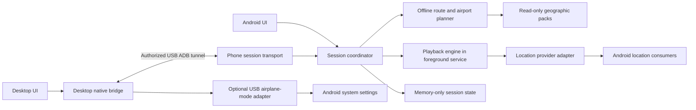
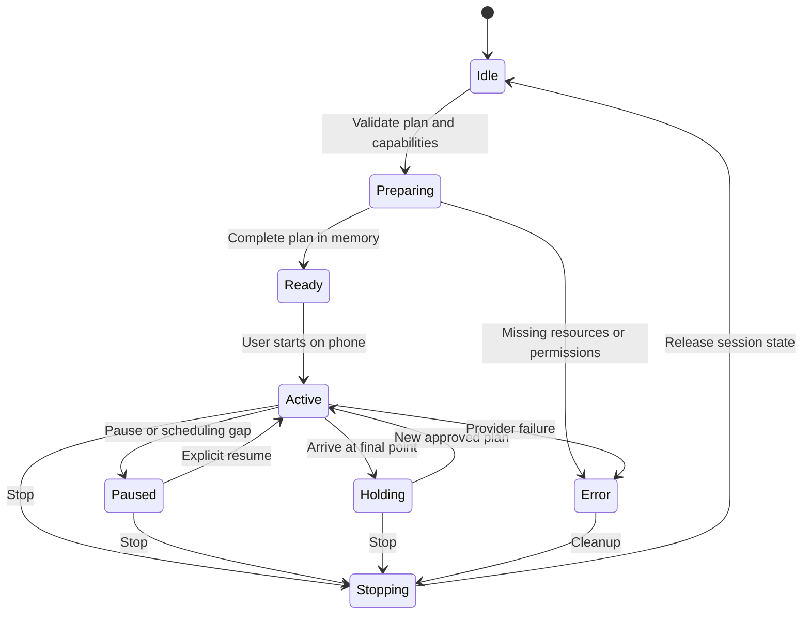

# Local Android Location Simulator — proposed architecture

**Current 0.6 scope (2026-10-03):** Explicit local saved places/routes are now authorized; phone has an online world map/search. Read [current map-first architecture](MAP_FIRST_V06_PLAN.md) and [current handoff](BUILD_HANDOFF_SOL_6_1.md). The original exclusions below are historical.

**Prior scope (2026-10-02):** The user selected online-first worldwide Windows maps/routing with optional offline maps. [WORLDWIDE_MAP_PLAN.md](WORLDWIDE_MAP_PLAN.md) supersedes this original document’s fully offline runtime/map boundary and regional default. Android playback remains local and phone-owned. Provider logging is disclosed; full-planet offline routing and standalone Android worldwide maps remain unfinished.
Date: 2026-10-02. Original scope: planning and architecture only. The user subsequently authorized implementation; see [current build status](BUILD_STATUS.md) and [accepted initial geography adapters](adr/0004-initial-local-geopack-adapters.md). This document preserves the original design and qualification gates.

Latest requirement clarification: worldwide mapping/routing and Windows-first testing are required. The bounded regional GeoPack implementation is insufficient for final coverage. [WORLDWIDE_MAP_PLAN.md](WORLDWIDE_MAP_PLAN.md) records the accepted online-first decision, implemented worldwide Windows adapters and remaining offline/Android scope.

## 1. Product intent and boundaries

Build a free Android application that can simulate a fixed location, walking, driving, and a staged airport journey. Users can operate a sideloaded APK directly or connect the phone to a desktop controller. There is no product account, sign-up, subscription, advertising, analytics, remote control service, or runtime cloud dependency.

The [Wiped reference site](https://www.wiped.me/) describes an iPhone product with teleporting, route building, and phone operation after desktop setup. This design takes those interaction ideas and adapts them to Android's public mock-location mechanism. Saved locations and saved routes are deliberately excluded because the requested product retains no user activity.

The Android requirement is **no root, bootloader unlocking, or system modification**. On Android, “no root” is the relevant equivalent of “no jailbreak.” That is a technical property, not a guarantee of legality in every situation. The architecture does not promise acceptance by Life360 or any other third-party app.

### User requirements versus planning assumptions

| Item | Status | Design response |
|---|---|---|
| Android; outside app stores | User requirement | Signed, directly installable APK; optional desktop installer |
| Desktop and/or standalone APK | User requirement | One APK supports both; desktop is an optional controller |
| No login, ads, fees, logging, or retained activity | User requirement | No backend; memory-only activity; no logging pipelines |
| Instant, walking, driving, airport journey modes | User requirement | Explicit session modes described below |
| More than 250 miles suggests an airport journey | User requirement | Product threshold, never described as a Life360 detection rule |
| Windows first; macOS/Linux later | Proposed assumption | Cross-platform desktop stack; Windows delivery first |
| Static offline maps/airports may remain installed | Proposed assumption | Read-only geographic resources; never save selected places or searches |
| Android 10/API 29 minimum | Proposed baseline | Validate through the latest stable Android at implementation time |
| One phone and one active session | Proposed initial scope | Explicit device selection; no fleet features |

If “no stored data” includes static data files, use bundled resources and session-only imports instead. The app binary and OS installation metadata necessarily remain installed. Do not silently relax the no-activity-retention requirement.

## 2. Feasibility and truthful product claims

| Capability | Standalone APK | Desktop plus APK |
|---|---|---|
| Set and hold a location | Public mock-location support after user setup | Same phone engine, commanded over USB |
| Walk/drive along a route | Offline route calculation and playback | Route editing on desktop; execution on phone |
| Continue with screen off | Foreground service, subject to power/OS behavior | Same; USB connection is unnecessary for ordinary playback |
| Select mock-location app | User chooses it in Developer options | Desktop guides the user through phone setup |
| Toggle airplane mode | User changes system settings | Optional capability-tested ADB operation while USB remains connected |
| Defeat mock-location detection | No | No |
| Change IP, cell towers, Wi-Fi location, or another app's stored history | No | No |
| Recover a route after process death/reboot | No, intentionally | No, intentionally |

Android labels locations injected through test providers as mock and requires the app's mock-location operation to be allowed. Receiving apps can inspect that marker. [LocationManager API](https://developer.android.com/reference/android/location/LocationManager)

An ordinary application cannot write global airplane-mode settings. AOSP contains a connectivity shell operation for airplane mode, but its presence and permission on a particular OEM build must be verified. An authorized USB desktop session can attempt that supported shell path without rooting; the APK alone cannot assume the same privilege. [Settings.Global](https://developer.android.com/reference/android/provider/Settings.Global), [AOSP connectivity service source](https://android.googlesource.com/platform/packages/modules/Connectivity/+/0eccf35b6b1b123996ee41e4cc078cf79c35be89/service/src/com/android/server/ConnectivityService.java)

Airplane mode is not proof that all networks or location sources are off. Wi-Fi can remain enabled; GNSS and cached locations may remain available. A staged journey does not guarantee a particular third-party tracking display or erase already uploaded events.

## 3. System structure

The phone is authoritative for session state, route timing, validation, and location injection. Neither UI supplies a stream of mandatory per-second coordinates. Both submit plans and commands to the coordinator. Once acknowledged as ready, an ordinary plan is complete in phone memory and can run without the desktop.

The desktop is authoritative only for its USB connection and optional shell operations. It cannot declare that a phone session is running merely because a command was sent. It displays phone acknowledgments and marks status unknown when the connection becomes stale.

### Proposed technology choices

| Area | Proposal | Reason / gate |
|---|---|---|
| Android | Kotlin, Jetpack Compose, coroutines | Direct access to Android lifecycle and service APIs |
| Session domain | Plain Kotlin with platform adapters | Deterministic timing and state tests without Android UI |
| Desktop | Tauri 2, Rust bridge, TypeScript UI | Small controller, native USB tooling boundary, later cross-platform packaging |
| Maps | MapLibre Native on Android; MapLibre GL JS on desktop | Offline rendering candidates; no hosted map services |
| Routing | Embedded BRouter engine on phone | Offline Java/Android routing; desktop submits requests to phone |
| Airports | Bundled, versioned OurAirports snapshot | Local nearest-airport queries without network calls |
| Transport | Versioned, length-prefixed JSON over ADB-forwarded local socket | Simple inspection in synthetic tests, no phone internet permission for the socket |
| User data persistence | None | No activity database, preference history, or recovery journal |

BRouter supports Java/Android and uses MIT licensing; integrate its engine rather than requiring a separate routing app. Its default file-writing behavior must be audited and adapted. OurAirports publishes public-domain data without an accuracy guarantee. Neither dataset is a live flight schedule. [BRouter project](https://github.com/abrensch/brouter), [BRouter license](https://github.com/abrensch/brouter/blob/master/LICENSE), [OurAirports data](https://ourairports.com/data/)

Tauri provides an incognito window option. That option alone is not evidence that no sensitive material reaches disk. MapLibre's offline APIs also have storage behavior requiring review. These choices remain conditional on filesystem and network tests; replace an adapter if it fails the privacy contract. [Tauri configuration](https://v2.tauri.app/reference/config/), [MapLibre Android offline API](https://maplibre.org/maplibre-native/android/api/-map-libre%20-native%20-android/org.maplibre.android.offline/index.html)

Do not introduce a desktop routing JVM in the initial release. Desktop planning requires the connected APK; standalone planning happens directly on the phone. Both use the same route engine and profile definitions.

### Module ownership

| Module | Owns | Must not own |
|---|---|---|
| Session domain | Plans, state transitions, validation, virtual clock, current snapshot | Files, network, Android services |
| Android runtime | Foreground service, notification, permission checks, lifecycle, wake-lock lifecycle | Saved session recovery |
| Provider adapters | Prepare, inject, health, cleanup | UI claims about third-party acceptance |
| Geographic resources | Read-only map/routing/airport packs; local indexes | Search history or route-result caches |
| Android UI | Setup, mode selection, preview, stop/recovery controls | A second playback loop |
| Phone transport | Pairing, framing, command authorization, bounded queues | Arbitrary shell execution |
| Desktop bridge | Device selection, APK installation, tunnel, optional radio commands | Retained serials, routes, tokens, or raw diagnostic logs |
| Desktop UI | Map and plan editor; current phone status | OS commands, remote pages, browser persistence |

## 4. Phone setup and background execution

### Setup journey

1. User installs the signed APK directly or through the desktop installer.
2. The app explains how to enable Developer options and select this app as the mock-location app.
3. User grants the required location/service permissions and enables device location services.
4. App checks provider readiness; user picks an explicit origin or requests a one-time current-location read before mocking starts.
5. User starts a session while the Android activity is visible. The service owns playback afterward.

Do not repeatedly request actual device location during a session. Once mocking begins, a “current location” read may itself be simulated. Keep the plan origin explicit and label its source.

### Foreground service contract

Use a user-started service of type `location`, with the corresponding foreground-service permissions and applicable location permission. Start it from the visible activity to satisfy modern while-in-use and background-start restrictions. No background-location permission is planned initially. A desktop request received while the service is absent becomes a pending in-memory start that the user activates on the phone. [Service types](https://developer.android.com/develop/background-work/services/fgs/service-types), [Background-start restrictions](https://developer.android.com/develop/background-work/services/fgs/restrictions-bg-start)

The notification says “Location simulation active,” exposes Pause/Resume and Stop, and omits coordinates and place names. Request notification permission where applicable; explain reduced visibility if denied. Keep Stop accessible in the app and Android's own active-app controls. Do not hide the service or spoof another service type.

Proposed runtime behavior:

- UI dismissal does not intentionally stop a session. Activity recreation reconnects to live service memory.
- Service restart policy does not reconstruct or replay sessions. No boot receiver or automatic restart loop.
- Route simulation uses elapsed monotonic time and bounded work on a dedicated coroutine context; map rendering cannot block it.
- Begin with a 1 Hz location-injection target. Treat it as a measured target, not a real-time guarantee.
- Use a session-scoped partial wake lock only if device testing shows it necessary; impose renewable time bounds and release on pause/stop/error according to the measured hold strategy.
- Offer a user-opened battery settings guide when needed. Do not silently change battery policy.
- A scheduling gap exceeding five seconds pauses route progress at the last emitted position. Resume deliberately, with an updated arrival estimate; do not skip across the missing interval.
- Holding a location still needs fresh updates. A UI “paused” state freezes route progress while continuing those updates.

Doze may defer execution and ignore wake locks unless relevant exemptions apply. Foreground-service use alone is not an uninterrupted-execution guarantee. Power behavior must be measured on real devices. [Doze guidance](https://developer.android.com/training/monitoring-device-state/doze-standby)

### Stop, crash, and recovery semantics

Normal Stop cancels playback, disables/removes the app's test-provider overrides, exits any active fused mock mode, releases resources, closes controller access, and drops sensitive in-memory state. Only touch overrides owned by this app. A cleanup failure produces a visible error and recovery instructions, without retaining the old plan.

Android can terminate the process without a cleanup callback, including through its active-app Stop control. Therefore a hard stop cannot promise immediate provider restoration or an instantaneous true-location fix. Other apps may retain the last location. [Android user-stop behavior](https://developer.android.com/develop/background-work/services/fgs/handle-user-stopping)

Every cold launch offers a provider reset before creating a new session. It does not claim to remember a previous session. If cleanup cannot be confirmed, instruct the user to deselect the mock-location app and toggle location services or reboot as appropriate to the tested device. Never fabricate a recovered session.

## 5. Location injection and interoperability

Define a provider adapter contract: capability check, prepare, submit sample, report current health, and best-effort cleanup. Treat provider startup as a transaction: if any required adapter fails, undo successfully prepared adapters before displaying an active state.

The first feasibility path is the framework `LocationManager` test-provider API. Test GPS and network consumers explicitly rather than assuming replacing one provider covers all apps. Avoid inventing a generic “fused” test provider and claiming equivalence with Google Play services.

A separate, optional Google fused-location adapter is a compatibility candidate. Google's mock mode affects other FLP clients, requires mock-app selection, and must be exited when finished. Its process-wide behavior, interaction with framework providers, and privacy implications require a separate gate. [FusedLocationProviderClient](https://developers.google.com/android/reference/com/google/android/gms/location/FusedLocationProviderClient)

Default to the framework-only build until measurements justify any extra dependency. If an optional GMS build is needed, document the dependency and ensure it introduces no app analytics or remote requests. The product cannot control what already-installed system services do. Do not describe one build as universally compatible.

Samples include valid coordinates, accuracy, provider identity, wall-clock timestamp, and increasing elapsed-realtime timestamp. Moving samples include speed and bearing derived from the actual geometry and timeline. Supply altitude only when the resource model supports it; never manufacture sensor certainty. Keep the Android mock marker intact.

State shown to users distinguishes:

- Plan accepted by this app.
- Sample submitted successfully to the selected provider adapter.
- Sample observed by a separate test consumer.
- Third-party application behavior, which is independently verified or unknown.

Do not equate the first two with Life360 accepting the result. No per-app injection, application hooking, mock-flag removal, integrity bypass, or location-history editing is part of this design.

## 6. Session and movement model

### State model

Flight phases are nested under Active. Radio control has an independent capability/status model so connectivity errors cannot masquerade as location success. Physical process death destroys this state machine's instance; a new process starts at Idle.

### In-memory entities

| Entity | Contents |
|---|---|
| Session | Random identifier, revision, mode, current state, capabilities |
| Plan | Origin, destination, route segments, speed profile, endpoint behavior |
| Route segment | Geometry, cumulative distance, mode, dwell duration, speed constraints |
| Flight plan | Chosen airports, surface routes, phase durations, radio-control policy |
| Playback snapshot | Current point, elapsed simulation time, phase, latest injection health |
| Controller lease | Ephemeral credential, expiry, last sequence, bounded acknowledgment cache |
| Radio operation | Initial airplane state, expected state, phase identifier, whether app changed it |

No timeline of past snapshots is retained. Current state is necessary to operate the session; replace and discard old snapshots. Bound command deduplication to a small in-memory window, then erase it on session end.

### Instant mode

User selects a coordinate and starts. The engine sets that point and keeps refreshing it until Stop or a replacement plan. Instant means no simulated travel delay; it does not promise synchronous updates in every receiving app.

### Walking and driving

Build road/path geometry locally using the correct profile. Initial adjustable defaults: walking 1.4 m/s and driving 13.9 m/s, with explicit units and profile-specific bounds. Driving uses segment constraints where available; it must not assume every road permits a universal fixed speed. Acceleration/deceleration and optional user-defined stops smooth transitions. These are playback controls, not a claim of undetectability.

Distance advances from speed and elapsed simulation time, interpolated along cumulative geometry. Handle zero-length segments, duplicate waypoints, sharp turns, coordinate validation, antimeridian crossing, and end-of-route precision. Loops and reverse routes are later additions unless explicitly requested.

At the destination, enter Holding by default. Stop releases mocking; it does not mean “stay here.” This distinction must be visible in both interfaces.

If a road route cannot be calculated, say so. Offer a separately labeled custom straight-line path when useful; never present a straight line over water or missing map data as a valid driving route.

## 7. Airport journey mode

### Trigger and planning

When origin-to-destination great-circle distance exceeds **250 statute miles = 402,336 meters**, offer an airport journey preview. Exactly 250 miles does not trigger the suggestion. The user may still choose instant or ordinary route mode. This is a configurable product heuristic, with no claim that Life360 uses that threshold.

Use the current simulated position as origin during an active session. Otherwise use a user-selected origin or a one-time device fix obtained before mocking. Never infer the origin by silently tracking the user.

Search the bundled airport index for nearby open airports, preferring medium/large airports with scheduled service. Rank a bounded candidate set by reachable surface travel where offline routing data exists. Show the selected origin and destination airports and let the user change them. If only straight-line proximity is available, label that basis. Avoid heliports, closed airports, and small private strips by default.

This is a simulated itinerary, not a booking or assertion that a flight exists. Missing airports, disconnected ground routes, unavailable packs, or identical origin/destination airports require a revised plan before starting. Precompute both surface legs and all required resources before changing connectivity.

### Phase sequence

| Phase | Location behavior | Connectivity / transition |
|---|---|---|
| Preview | Existing session unchanged | Show airports, route coverage, all durations, control mode |
| Travel to origin airport | Walking or driving geometry | Arrive at chosen airport endpoint |
| Boarding hold | Hold origin-airport coordinate | User-selected dwell, then request airplane mode |
| Await airplane mode | Continue origin hold | Confirm observed airplane state; offer a clearly labeled simulation-only alternative |
| Flight interval | Continue holding origin coordinate | Wait a displayed nonzero duration; no claim of preventing real fixes or network traffic |
| Arrival placement | Inject destination-airport coordinate | Keep airplane mode as-is; verify provider submission and a short settling window |
| Restore connectivity | Hold destination airport | User turns mode off, or capable desktop restores the initial state it changed |
| Destination leg | Follow precomputed ground route | Finish in Holding at final destination |

Use a transparent estimated flight duration, such as airport distance divided by a configurable cruise speed plus explicit departure/arrival buffers. Show and allow editing of the result before start. Do not use an instantaneous “flight” as the default. Simulation-only mode follows the same timeline but makes no radio-control claim.

The flight interval does not disable the app's provider and allow an uncontrolled fallback by design; it continues refreshing the origin hold when Android permits it. That still cannot guarantee what every consumer sees. If airplane mode disables a required location capability on a device, stop advancing the journey and show recovery instructions.

### Radio control rules

Standalone mode opens Android settings through a user action and observes the result when possible. The app cannot silently flip the switch. If a system-settings activity cannot be resolved, show manual instructions. Background phases use a notification action rather than unexpectedly launching settings over another app.

Desktop automation is optional, opt-in per journey, and enabled only after the device's shell capability and USB transport have passed testing. Read state first; never toggle radios merely to probe support. Display the intended change in the preview. Keep flight progression on the phone and send phase-specific requests to the desktop with deadlines and acknowledgment.

Restore only a setting that this session changed, to its captured initial state. If airplane mode was already on, do not turn it off automatically. If the user intervenes or observed state differs from expectations, defer to manual control. Do not claim to restore every individual Wi-Fi/Bluetooth preference.

When USB disconnects, heartbeat expires, the laptop sleeps, or an operation times out, convert the radio transition to a phone-guided step. Ordinary location holding continues if possible. Do not jump to arrival or assert connectivity is restored. Disable wireless ADB in the initial design, because airplane mode can break that control path.

A desktop crash or phone process death may leave airplane mode enabled. There is intentionally no persistent recovery journal. The live peer may show a recovery action; after both processes die, manual recovery is required. This limitation is part of the feature, not a bug that may be “fixed” by secretly storing journey history.

## 8. Desktop connection and local protocol

ADB requires USB debugging and the user's authorization of the computer. It can install APKs and forward connections. The desktop must select one concrete device and scope every operation to it. [Android Debug Bridge](https://developer.android.com/tools/adb)

The release build does not need to be debuggable. Open a phone-local abstract socket only while the user has enabled desktop control. Forward a dynamically allocated desktop loopback port to that socket. Reject LAN binding and disable discovery over Wi-Fi. Confirm socket behavior and SELinux compatibility in the feasibility phase.

Add application-level session authorization beyond ADB's host trust. A practical initial design is a single-use 128-bit pairing secret displayed on the phone and entered on desktop, expiring after two minutes. After pairing, require phone confirmation, bind one controller, rotate to a session credential, and rate-limit failed attempts. Do not store secrets, use the clipboard automatically, or put them in process arguments, URLs, logs, or notification text. This is local device authorization, not a user account.

Use bounded, length-prefixed JSON frames. Envelope fields are protocol major/minor, random session identifier, command identifier, monotonic sequence, expected state revision, message type, and payload. Initial limit: 1 MiB per frame. Large geometry uses bounded chunks followed by explicit validation and commit; incomplete transfers cannot activate a plan.

| Commands | Semantics |
|---|---|
| Hello / Capabilities | Negotiate versions and available providers/radio operations |
| PreparePlan / CommitPlan | Validate complete plan; atomically replace only on success |
| Start / Pause / Resume / Stop | Session transitions; Start may require a visible phone action |
| Snapshot | Return current state, never historical events |
| Heartbeat | Detect connection loss; proposed 2-second interval, stale after 6 seconds |
| RadioPhaseResult | Report a specific requested operation and observed result |

Reject unknown major versions, oversized frames, stale session credentials, invalid coordinates, nonfinite numbers, expired commands, and out-of-order mutations. A repeated command identifier gets the previous acknowledgment while it remains in the bounded deduplication window. Failed plan replacement leaves the old plan untouched.

The phone serializes UI and desktop mutations. Local phone Stop always takes precedence. A phone plan edit invalidates an older desktop revision so delayed packets cannot overwrite it. On disconnect, the controller lease is revoked; reconnect requires pairing and retrieves a fresh snapshot. Ordinary route playback continues from phone memory.

Expose only specific native bridge operations. No generic shell endpoint or arbitrary file read/write from the desktop UI. Launch tools with argument arrays, not shell concatenation. Forward/remove only this application's tunnels and never kill another application's shared ADB server.

## 9. Privacy, storage, and offline geographic data

### Enforceable privacy promise

“No accounts, ads, telemetry, or saved location history. Your current simulation is processed locally in memory and discarded when stopped or when the app process ends.”

The app cannot guarantee that the OS, keyboard, swap, crash facility, ADB, Play services, or an app receiving mock locations retains nothing. ADB can maintain host authorization material and diagnostics. Another app may upload the simulated coordinates. Do not market this as device-wide zero traces or secure erasure of RAM.

| Data | Runtime location | Persistence rule |
|---|---|---|
| Coordinates, destinations, queries, routes, selected airports | Phone/desktop memory | Never write to disk or backup |
| Active phase, timing, credentials, device serial | Bounded memory | Drop at session/connection end |
| Current errors/health | Current UI state only | No event log, ring-buffer history, crash upload, or diagnostics export |
| App settings such as speed or units | Memory; bundled defaults on restart | No preferences database initially |
| Static maps, routing segments, airport/place indexes | Bundled or explicitly imported read-only packs | Allowed under the stated planning assumption |
| Pack version, license, bounds, checksum | Pack manifest | Static resource metadata only |
| App binary/signing/install information | OS installation | Unavoidable platform state; contains no activity records |
| ADB trust and OS diagnostics | External tool/OS | Disclose separately; audit before packaging |

“No logging” means no operational logging from our app, including SDK logs, console logs, native logs, route debugging output, analytics events, or error payload dumps. Do not implement a hidden debug toggle in shipping builds. Development tests may emit synthetic pass/fail evidence without real coordinates or device identities.

Prevent incidental retention: no SavedStateHandle or saveable UI state containing locations, no recent-search list, no recent-document registration for activity files, no web local/session storage, IndexedDB, cookies, service workers, browser history, form autofill, session restore, or persistent route caches. Use generic window titles and notifications. Avoid automatic clipboard use. Request appropriate Android keyboard no-learning behavior and protect sensitive previews; external keyboards and OS capture remain outside the guarantee.

Disable app backup and define explicit data-extraction exclusions for cloud backup and device transfer. Android documents OEM variation in backup behavior, which reinforces keeping sensitive state out of files in the first place. [Android backup guidance](https://developer.android.com/identity/data/autobackup)

### Offline resource policy

Bundle a coarse world map and airport index. Regional packs contain map tiles, all needed styles/fonts/sprites, a local place-name index, and routing graph segments. Full street-address coverage is not promised for every region; coordinate input always works.

Read imported packs locally. No runtime geocoding, routing, map-tile, font, telemetry, or update requests. The initial product has no in-app downloader; users obtain static packs separately and import them. Any external download host may keep its own access records, so it is outside the runtime privacy claim.

Use checksummed, versioned pack manifests with schema, coverage, source date, size, attribution, and compatible routing profiles. Verify distribution provenance/signatures where supplied. Validate archives against path traversal, malformed geometry, excessive expansion, and unsupported formats. Imports may persist static resource content only, not user-selected map centers or resource-access history. OS file-access metadata may still exist.

Map resource adapters must read local archives without enabling persistent caches of viewed areas. Disabling a cache after using it is insufficient. Prove the Android MapLibre archive/resource integration and the desktop custom resource handler before finalizing those dependencies. If they cannot meet the activity-retention rule, change the renderer or narrow the first release rather than hiding a cache.

Missing packs produce explicit coverage errors. No automatic online fallback. Build/host map packs from sources that permit redistribution; do not bulk-download the public OSM tile service, whose policy disallows offline prefetching. Include required attribution and applicable data-license terms. [OSM tile policy](https://operations.osmfoundation.org/policies/tiles/)

## 10. Delivery, support scope, and failure behavior

Ship a signed universal APK initially, with ARM64 device support and emulator support for testing as appropriate. Retain the release signing key securely outside the app and repository. Stable signing identity is needed for upgrades; it is publisher infrastructure, not end-user activity storage.

Desktop installation uses a locally included or user-provided APK after verifying the expected package and signer. Updates are manual signed downloads; no automatic check, updater service, or account. Verify whether Platform Tools can be bundled under their distribution terms; otherwise guide users to the official download and let them select it each session. Do not download or install silently.

Direct APK distribution remains a target, but Android developer verification is evolving. Google's FAQ currently distinguishes the September 30, 2026 participating-store rollout from direct sideloading and discusses later expansion and an advanced installation flow. Recheck exact region/device requirements before release; do not promise that avoiding a store avoids all platform installation checks. [Developer verification FAQ](https://developer.android.com/developer-verification/guides/faq)

No fees means the user does not pay for product features. It does not imply free bandwidth, signing services, or zero maintainer costs. The runtime requires no paid API. Product source-code licensing remains an owner decision; preserve third-party notices regardless.

| Failure | Required result |
|---|---|
| Mock permission revoked / location disabled | Stop progression, attempt cleanup, show exact missing prerequisite |
| Notification permission denied | Explain visibility limits; retain in-app controls and system-compliant behavior |
| Route calculation fails | Keep previous plan; show missing coverage or no-route error |
| Phone UI closes | Service continues when OS permits; no UI-owned playback dependency |
| USB lost | Continue normal phone session; desktop shows disconnected; radio automation becomes manual |
| Provider partially starts | Roll back prepared providers; never show full success |
| Process killed / force stop / reboot | No session recovery; next launch starts idle with provider-reset option |
| Airplane operation fails | Remain at current journey phase with visible retry/manual control |
| Disk/cache privacy audit fails | Block that component's release; do not add an undocumented retention exception |
| Third-party app rejects mocks | Report compatibility limitation; no stealth workaround |

## 11. Implementation gates and acceptance evidence

These are planned checks, not completed tests. Only documentation exists now.

1. **Platform feasibility:** On real devices, prove framework mock injection and normal cleanup, measure framework versus FLP consumers, and test airplane-mode capability without assuming OEM parity. Include hard-stop recovery observations.
2. **Privacy feasibility:** Audit the proposed map/routing SDKs, desktop webview, and ADB subprocesses. Run with egress blocked. Compare files before/after normal use, stop, crash, and restart using synthetic distinctive inputs. Any activity-bearing file is a failure.
3. **Session core:** Verify monotonic timing, pause/hold semantics, route interpolation, invalid-input rejection, atomic plan replacement, and priority of phone Stop.
4. **Background behavior:** Test at least a two-hour screen-off session, Doze, battery saver, UI dismissal, permission revocation, memory pressure, force-stop, and reboot on representative Pixel/AOSP and Samsung devices; add another restrictive OEM before broad claims. Record observed injection intervals and battery cost without production telemetry.
5. **Desktop transport:** Test two attached phones, rejected pairing, stale/replayed messages, partial/oversized frames, unplug, laptop sleep, desktop crash, and reconnect. No mutations reach the wrong phone.
6. **Journey behavior:** Test below/at/above 402,336 meters, missing airports, missing origin/destination packs, manual airplane flow, conditional USB flow, user radio changes, and failure at every phase boundary.
7. **Distribution:** Validate release APK signing, direct installation and upgrade, install prompts on target regions/devices, offline operation, attribution, and no unexpected permissions or network connections.

The initial support matrix should cover Android 10, 12, 13, 14, 15, 16, and the latest stable release available at implementation, using emulators for broad API behavior and physical devices for USB, radio, and power behavior. Version support is earned by testing, not inferred from the minimum SDK.

Every compatibility result states device/OS build, provider adapter, consumer API, and observed behavior. Use a separate synthetic test consumer to verify received samples. Any Life360-specific acceptance claim needs separate authorized real-device testing and remains version-specific.

## 12. Differentiation

The distinction is a local, free, transparent utility: no account or payment flow, no saved travel history, no cloud maps, explicit offline coverage, one phone-owned session across desktop and APK, visible controls, and staged journeys with honest capability reporting. Reliability and verifiable privacy are the main differentiators. Undetectability is not a promised feature.
