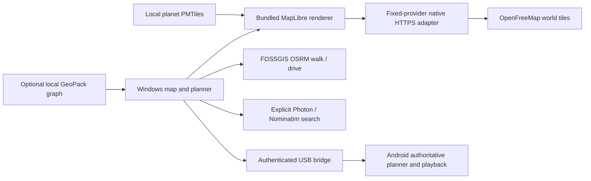

# Worldwide maps: online first, optional offline

Decision accepted on 2026-10-02: the user wants both online and offline options, with online primary and Windows testing first. Global coverage replaces the regional GeoPack as the default Windows mapping/routing experience. The APK still owns location playback.

## Current architecture

All executable scripts, styles and SDK modules ship locally. MapLibre 6.11.2, PMTiles 4.5.0 and Protomaps basemap styles 5.7.2 are pinned, with module hashes and licenses recorded. SDK diagnostic calls are disabled, and the PMTiles directory decoder has an entry bound. The production webview CSP permits local app/IPC resources only. Provider traffic goes through native Rust, which returns decoded resource bytes/data rather than provider headers. Cloudflare NEL/Report-To headers therefore never reach the renderer.

Native HTTPS uses fixed hosts and resource paths, an identifying user agent, no redirects/proxies/cookies, bounded time/response/decompression sizes and generic errors. Map resources use a 64 MiB RAM cache. Route/search requests have shared process-wide rate budgets, one concurrent request each, and a minimum 1.1-second interval. Search has an explicitly cleared RAM cache. Clear removes preview/input state and caches; closing/reloading the webview releases selected file/renderer state. An already submitted blocking HTTP request can finish up to its timeout; stale results cannot restore cleared state.

The development browser preview has direct-provider fallbacks for UI testing. Its ordinary browser HTTP behavior is outside production RAM/cache qualification. No remote script CDN is used in either path.

## Routing and phone validation

Walking and driving use distinct worldwide FOSSGIS profiles. Regular endpoints must snap within 250 m; routes have at most 12,000 points, a 1 MiB native response cap and bounded distance/segment validation. A route line follows supplied road geometry; an explicit custom straight path is visibly labeled.

Windows standalone preview works without ADB or Android. Online route geometry is sent to the phone only during authenticated phone preparation. The Android parser enforces exact wire fields, geometry/endpoints/profiles and total size. It independently owns selected speed, timing, foreground service, Stop, revision and radio transitions. The provider's road provenance cannot be independently certified from coordinates alone.

The static OurAirports catalog contains 3,269 scheduled-service medium/large airports worldwide. Airport catalog coordinates often lie on runways. Only an endpoint matching a selected eligible airport may snap up to 5 km to road access; ordinary user endpoints retain 250 m. The preview discloses access coordinates/distances and calculates the air leg between those actual road points. Both ground routes validate before staging any flight. Map previews cannot toggle a radio.

## Offline behavior and unfinished work

Selecting Offline disables map/search/route network requests. Import a separately acquired **planet PMTiles** file for global basemap coverage. Selected files are read locally in bounded ranges, with bounded directory/decompression caches. Supported formats are OpenMapTiles/Protomaps vector or PNG/JPEG/WebP raster. Vector label layers and sprite-dependent patterns are omitted so no font/icon HTTP fetch is needed. A small test raster proves the reader works; it is never distributed as geographic coverage.

A whole-planet file is approximately 120 GB through zoom 15; an overview is much smaller but does not replace worldwide street detail. Download a genuine full-planet archive from [Protomaps downloads](https://docs.protomaps.com/basemaps/downloads), verify its published integrity hash, then use **Import offline map**. The app does not retain the chosen filename/path after clearing or closing. Static geographic files you deliberately acquire remain on disk.

**Full-planet offline road routing is not yet implemented.** The existing GeoPack adapter is bounded local routing data, useful for an imported extract; a map archive alone supplies no graph. The standalone APK currently retains its offline maps/graphs and has no Internet permission. Future work needs an audited indexed global routing engine/data adapter for Windows and Android; BRouter is a candidate, not a shipped feature. Do not describe either remaining gap as complete.

## Provider privacy and operating limits

- [OpenFreeMap privacy](https://openfreemap.org/privacy/): map requests disclose viewed areas. The service retains anonymized logs and can enable temporary IP logging for security incidents; CDN behavior is separately governed.
- [FOSSGIS routing policy](https://routing.openstreetmap.de/about.html): **submitted routes are stored in server logs**. Walking/driving profiles cover the world; the service requires attribution, a Fix-the-map link, identifying agent and at most one request per second. No scraping/heavy use or availability guarantee. This integration is for modest local testing, not unqualified mass distribution.
- [Photon](https://github.com/komoot/photon): default explicit search with reasonable public-server usage. No autocomplete. Search queries disclose requested places to the provider.
- [Nominatim policy](https://operations.osmfoundation.org/policies/nominatim/): optional explicit search with limited public-service usage, no autocomplete. A process-local throttle does not prove aggregate policy compliance across every distributed app instance.

Accounts, ads, app fees and app activity persistence remain absent. Online mode cannot fulfill the original promise of no logging anywhere; the UI states the provider boundary. Actual OS/webview/crash/backup forensic qualification and real Android hardware tests remain pending.
